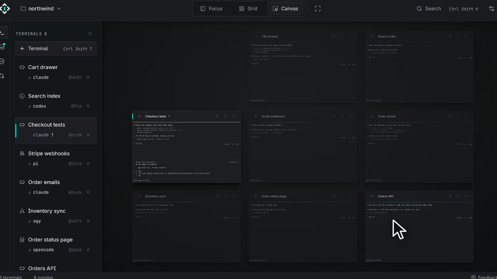
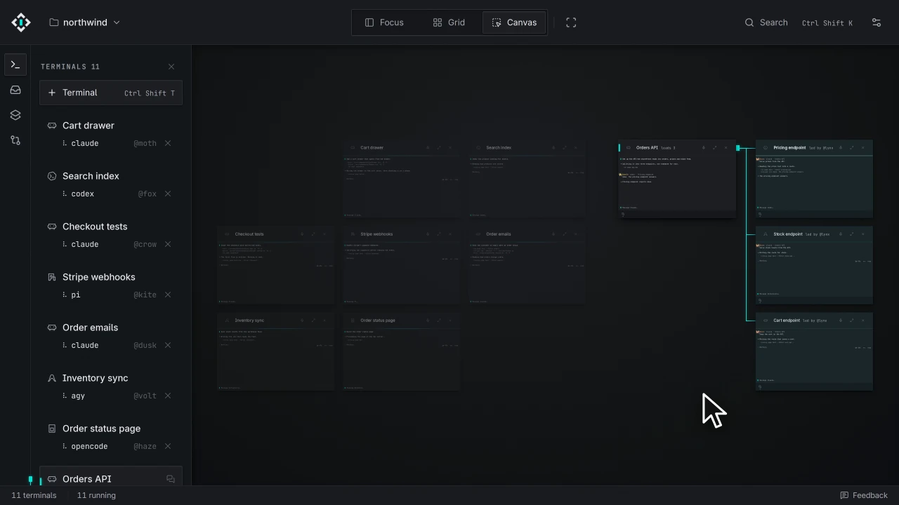

<p align="center">
  <a href="https://novadeck.dev/?utm_source=readme">
    <picture>
      <source media="(prefers-color-scheme: dark)" srcset="docs/assets/logo-dark.svg" />
      
    </picture>
  </a>
</p>

<p align="center">
  <strong>An agentic development environment for Claude Code, Codex, Antigravity, OpenCode and Pi.</strong><br />
  Run a bunch of agents at once, in real terminals, and actually keep up with them.<br />
  Free and open source, no account.
</p>

<p align="center">
  <a href="https://novadeck.dev/download?utm_source=readme"><strong>Download</strong></a> ·
  <a href="https://try.novadeck.dev">Try it in your browser</a> ·
  <a href="https://novadeck.dev/?utm_source=readme">Website</a>
</p>

<p align="center">
  <a href="https://github.com/novadeck-org/novadeck/releases/latest"></a>
  <a href="https://github.com/novadeck-org/novadeck/commits/main"></a>
  <a href="docs/guide.md#connect-your-agents"></a>
  <br />
  <a href="https://novadeck.dev/download?utm_source=readme"></a>
  <a href="https://novadeck.dev/privacy?utm_source=readme"></a>
  <a href="LICENSE"></a>
</p>

<p align="center">
  <a href="https://youtu.be/m3utO-zBN-k">▶ Watch the 2-minute tour</a>
</p>

I run like four or five coding agents a day. The agents are fine. Keeping up with them was NOT.
Tab, tab, tab to find the one that's waiting, copy-pasting answers between them, no idea which
branch had what. So now I use Novadeck.

It runs the agent CLIs you already have, on your own accounts. And it's not tmux with extra
steps: Novadeck knows what each agent is doing, so it can tell you who's waiting and pass their
messages around. All it adds is a small plugin to each agent. Your settings stay yours, and
outside Novadeck the plugin does nothing.

On macOS and x86_64 Linux:

```sh
curl -fsSL https://novadeck.dev/install.sh | sh
```

For Windows and portable builds, see
[novadeck.dev/download](https://novadeck.dev/download?utm_source=readme).

## See who needs you

<p align="center">
  
</p>

Every terminal says if its agent is working, asking, failed or done. I see who wants me without
opening anything. Focus for one, Canvas for all of them, Grid to tile.

## Answer them where you are

<p align="center">
  
</p>

Permission prompts, plans, questions. They all land in the Inbox. I answer from there, usually in
one click, and the agent's back at it.

## Stop being the meat proxy

<p align="center">
  
</p>

Half the stuff they ask me is really for another agent. Here they message each other by handle,
and one can start its own teammates and lead them. The lead gets their questions too and usually
answers before I even look. Claude Code, Codex, Antigravity, OpenCode and Pi, all on one team.

## Keep their work apart

<p align="center">
  
</p>

Each agent makes its own git worktree, so nobody edits over anybody, and my checkout stays mine,
which tbh was the main thing. The Worktrees panel has the PR, the checks and who's on it, and
cleans up after the merge.

## See what they're changing

<p align="center">
  
</p>

The Files panel shows all their changes in one tree, live, each file marked with who's on it.
Two of them going for the same file? I know before git does.

## Where'd it save that?

<p align="center">
  
</p>

Whatever an agent makes opens right next to its terminal. A page, a diff, an image, a video, a PDF,
a 3D model, a CSV, a whole folder even. No more digging for where it saved stuff.

## Drop me a ⭐

> [!IMPORTANT]
> It's just me out here. No team, no ad budget, not much sleep. Building all of this anyway.\
> Stars are how anyone finds it, and they keep me going. Think it's preem? You know what to do.
>
> Stay nova, choom ✦

## License

[GPL-3.0-or-later](LICENSE). Contributions come in under the [CLA](CLA.md).
