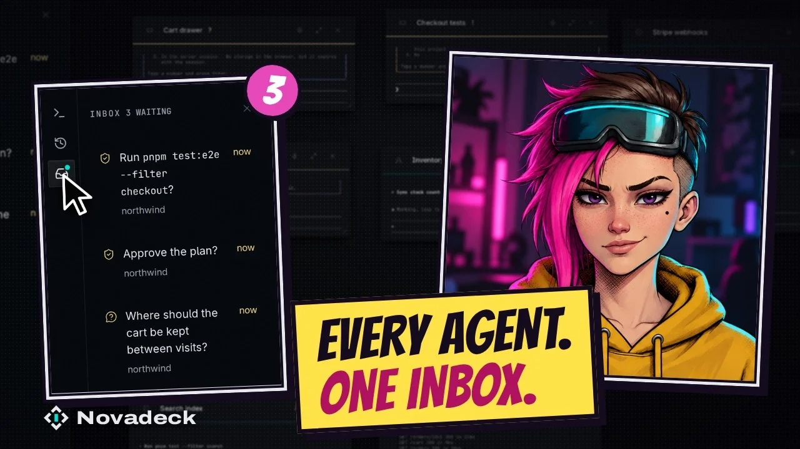
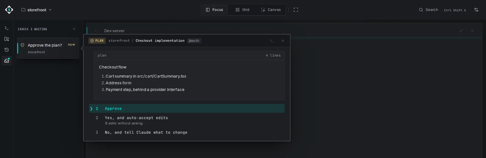
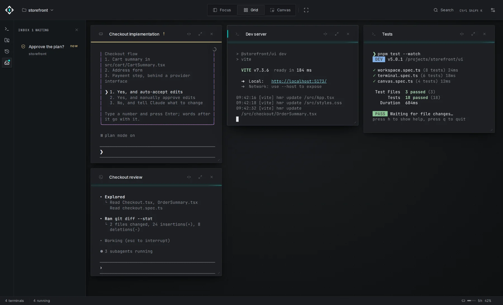
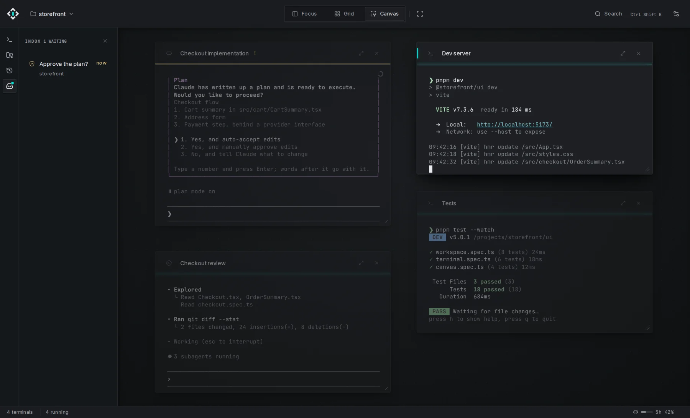

<p align="center">
  <a href="https://novadeck.dev">
    <picture>
      <source media="(prefers-color-scheme: dark)" srcset="docs/assets/logo-dark.svg" />
      
    </picture>
  </a>
</p>

<p align="center">
  A desktop terminal workspace for running coding agents side by side.<br />
  <a href="https://novadeck.dev">Website</a> ·
  <a href="https://novadeck.dev/download">Download</a> ·
  <a href="https://try.novadeck.dev">Try it in your browser</a>
</p>

<p align="center">
  <a href="https://youtu.be/m3utO-zBN-k">
    
  </a>
  <br />
  <a href="https://youtu.be/m3utO-zBN-k">▶ Watch the 2-minute tour</a>
</p>

Novadeck runs Claude Code, Codex and Antigravity in one window, through their own CLIs.
When an agent needs you, its question lands in one Inbox, and agents can message each other
to work as a team. Free, open source, no account.

## What it looks like

<p align="center">
  
</p>

Claude Code asks to approve its plan, and you answer from the Inbox without opening its terminal.

<p align="center">
  
  
</p>

Grid puts every terminal side by side. Canvas lets you arrange them freely on one board.

## Install

```sh
curl -fsSL https://novadeck.dev/install.sh | sh
```

On macOS and x86_64 Linux. For Windows and portable builds, see
[novadeck.dev/download](https://novadeck.dev/download).

## Docs

- [Guide](docs/guide.md): how Novadeck works, in detail.
- [Development](docs/development.md): setup, repository map, tests and releases.
- [Contributing](CONTRIBUTING.md) · [Code style](CODING.md) · [Security](SECURITY.md)

## License

[GPL-3.0-or-later](LICENSE). Copyright © 2026 Mateusz Pietrzak and contributors.
Contributions come in under the [CLA](CLA.md).
