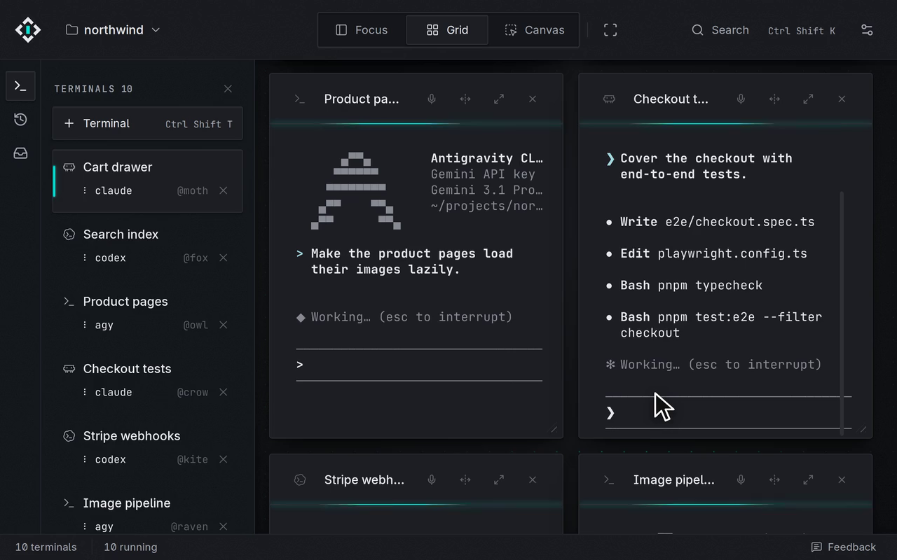
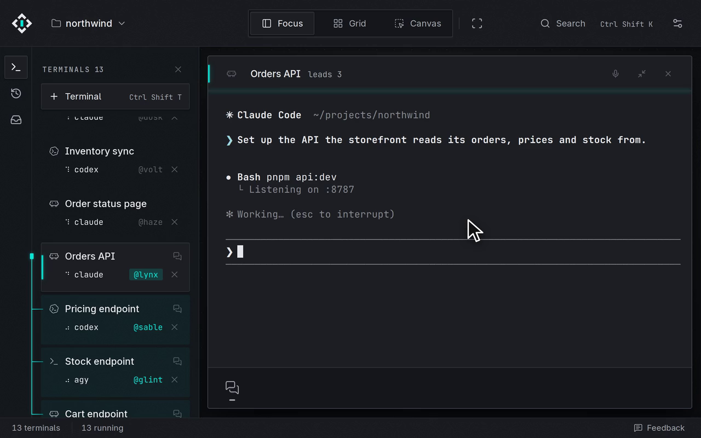
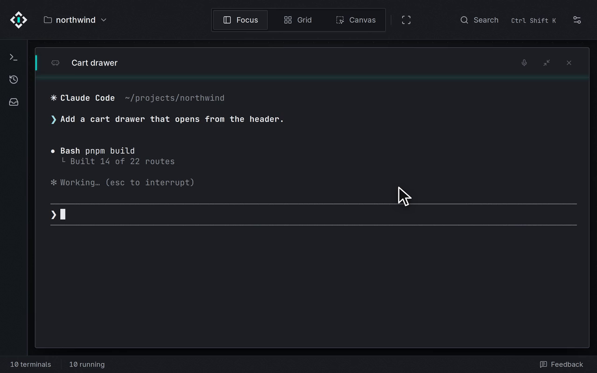
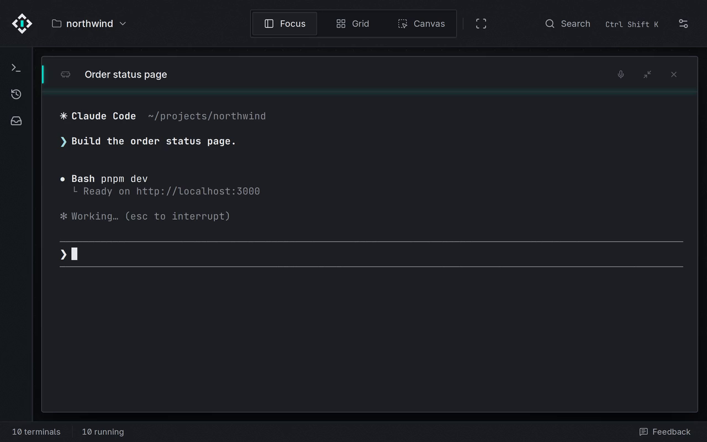
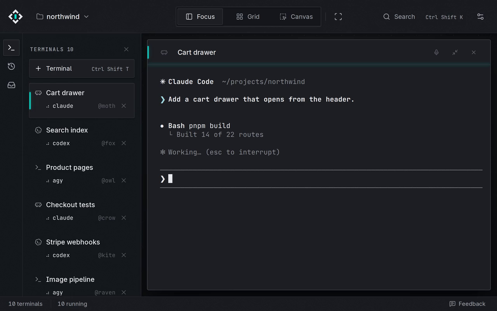

<p align="center">
  <a href="https://novadeck.dev/?utm_source=readme">
    <picture>
      <source media="(prefers-color-scheme: dark)" srcset="docs/assets/logo-dark.svg" />
      
    </picture>
  </a>
</p>

<p align="center">
  <strong>A desktop terminal for Claude Code, Codex and Antigravity.</strong><br />
  When an agent needs you, its question comes to one Inbox, and you answer it right there.
</p>

<p align="center">
  <a href="https://novadeck.dev/download?utm_source=readme"><strong>Download</strong></a> ·
  <a href="https://try.novadeck.dev">Try it in your browser</a> ·
  <a href="https://novadeck.dev/?utm_source=readme">Website</a>
</p>

<p align="center">
  
  <a href="https://github.com/novadeck-org/novadeck/releases/latest"></a>
  <a href="https://github.com/novadeck-org/novadeck/commits/main"></a>
  <a href="LICENSE"></a>
</p>

<p align="center">
  <a href="https://youtu.be/m3utO-zBN-k">▶ Watch the 2-minute tour</a>
</p>

No more tabbing through agents to find the one that's been stuck on a `[y/N]` for twenty
minutes. Novadeck runs them all in one window. When one needs you, it asks in your Inbox, so
there's no hunting for its terminal, and you can answer most questions right there. Free, open
source, no account.

## Answer them where you are

<p align="center">
  
</p>

Kick off four agents and go do your own thing. When one has a question or wants your OK to run
something, you get a ping, and the question waits in your Inbox with the answers as buttons.
Pick one and the agent carries on, no terminal needed. For the odd prompt Novadeck can't answer,
there's a button to its terminal. The other agents just keep working.

## Stop being the meat proxy

<p align="center">
  
</p>

Tell Claude _"get Codex to review this"_ or _"split this across three more agents"_ and they sort
it out between themselves. Claude, Codex and Antigravity can work in one team, each with its own
handle, and a line on screen shows who leads whom. Open an agent's Messages pane to read its
conversations, and check what they agreed before you trust the result.

## Run one, a few, or the whole crew

<p align="center">
  
</p>

Zoom in on one, tile a few in a grid or spread them all across a canvas. Same terminals in every
view, so switching never kills a run.

## Where'd it save that?

<p align="center">
  
</p>

When an agent shows you a page, a screenshot or its changes, it lands right next to its
terminal. You read it there, and then you get back to work.

## Back where you left off

<p align="center">
  
</p>

Restart Novadeck or your computer and every terminal comes back where it was, with Claude Code,
Codex and Antigravity back in the session they were in.

## Bring your own harness

Novadeck runs the real Claude Code, Codex and Antigravity, the CLIs on your machine, set up
exactly how you like them and signed in to your own accounts. Nothing gets rebuilt or wrapped.

## Install

```sh
curl -fsSL https://novadeck.dev/install.sh | sh
```

On macOS and x86_64 Linux. For Windows and portable builds, see
[novadeck.dev/download](https://novadeck.dev/download?utm_source=readme).

Want to find this again? A ⭐ keeps Novadeck in your GitHub stars, and helps other developers
find it.

## Docs

- [Guide](docs/guide.md): a short tour of how Novadeck works. The [reference](docs/reference.md) has every detail.
- [Development](docs/development.md): setup, repository map, tests and releases.
- [Contributing](CONTRIBUTING.md) · [Code style](CODING.md) · [Security](SECURITY.md)
- Found a bug or want something? [Open an issue](https://github.com/novadeck-org/novadeck/issues).

## License

[GPL-3.0-or-later](LICENSE). Copyright © 2026 Mateusz Pietrzak and contributors.
Contributions come in under the [CLA](CLA.md).
