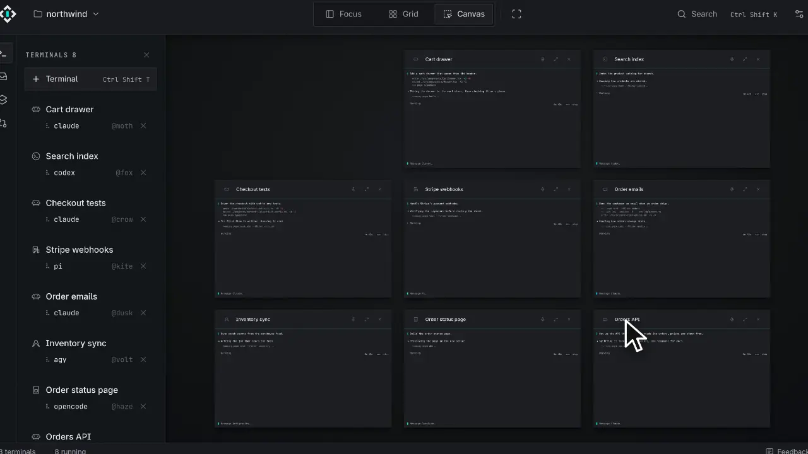
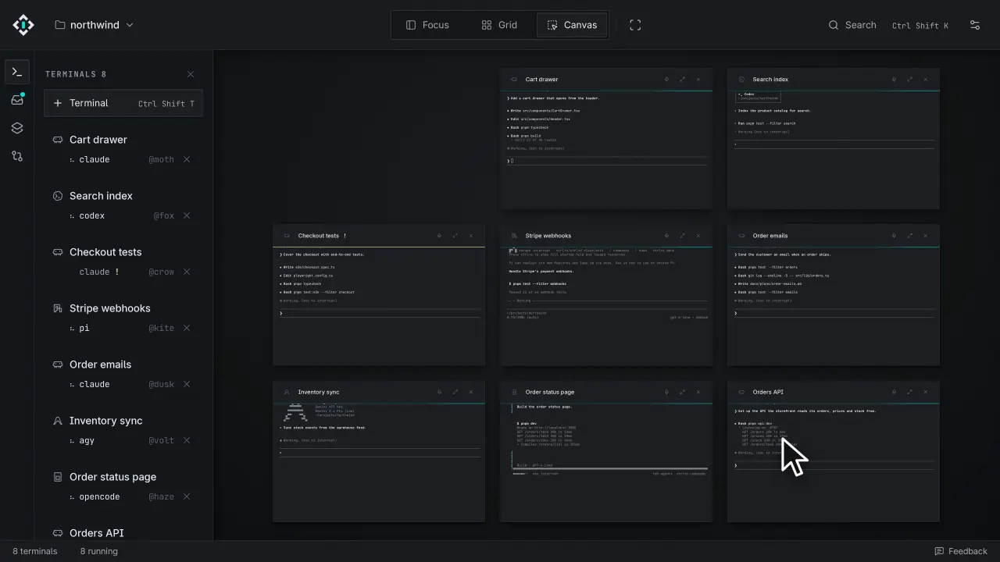
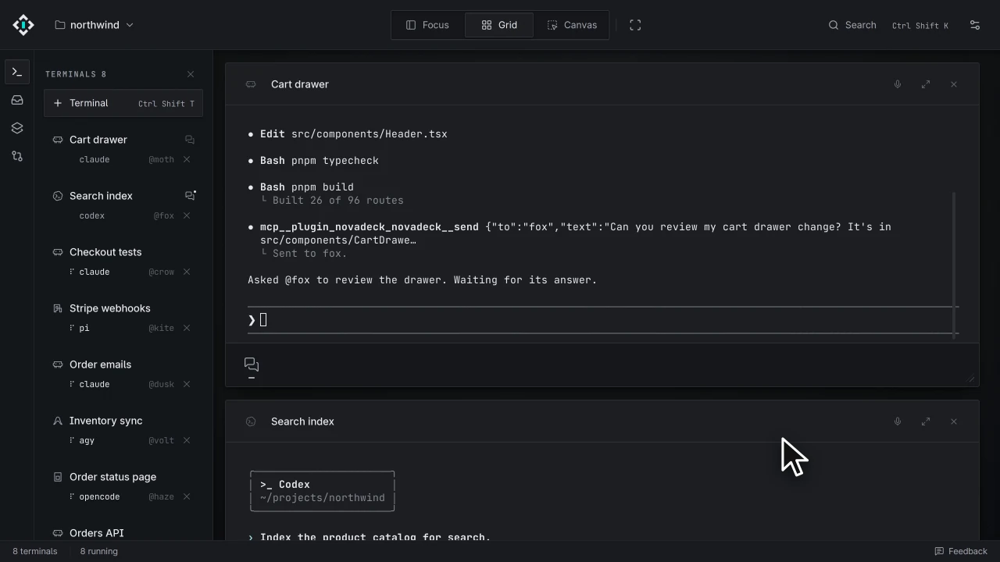
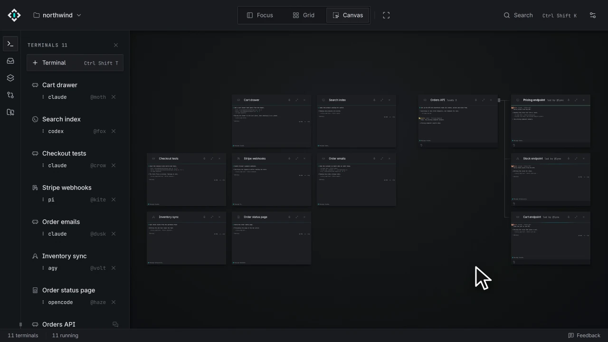
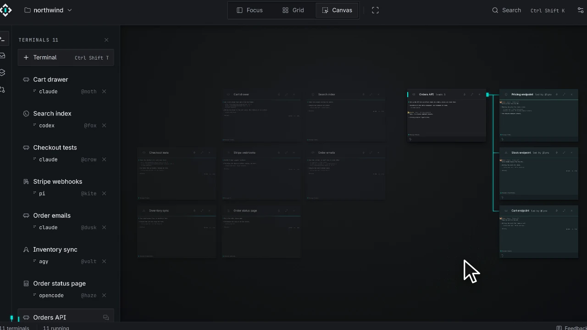
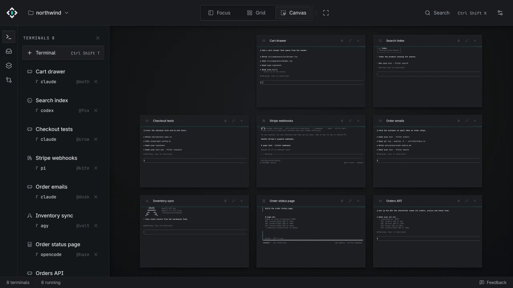

<p align="center">
  <a href="https://novadeck.dev/?utm_source=readme">
    <picture>
      <source media="(prefers-color-scheme: dark)" srcset="docs/assets/logo-dark.svg" />
      
    </picture>
  </a>
</p>

<p align="center">
  <strong>A desktop terminal for Claude Code, Codex, Antigravity, opencode and pi.</strong><br />
  When an agent needs you, its question comes to one Inbox, and you answer it right there.<br />
  Free and open source, no account.
</p>

<p align="center">
  <a href="https://novadeck.dev/download?utm_source=readme"><strong>Download</strong></a> ·
  <a href="https://try.novadeck.dev">Try it in your browser</a> ·
  <a href="https://novadeck.dev/?utm_source=readme">Website</a>
</p>

<p align="center">
  <a href="https://github.com/novadeck-org/novadeck/releases/latest"></a>
  <a href="https://github.com/novadeck-org/novadeck/commits/main"></a>
  <a href="docs/guide.md#connect-your-agents"></a>
  <br />
  <a href="https://novadeck.dev/download?utm_source=readme"></a>
  <a href="https://novadeck.dev/privacy?utm_source=readme"></a>
  <a href="LICENSE"></a>
</p>

<p align="center">
  <a href="https://youtu.be/m3utO-zBN-k">▶ Watch the 2-minute tour</a>
</p>

## Answer them where you are

<p align="center">
  
</p>

Every agent's permission prompts, plans and questions land in one Inbox. Most you answer with a click.

## Stop being the meat proxy

<p align="center">
  
</p>

Agents message each other by handle and start their own teammates. Claude Code, Codex, Antigravity, opencode and pi can share a team.

## Run one, a few, or the whole crew

<p align="center">
  
</p>

Every agent's state shows in the list. Focus, Grid and Canvas: the same terminals, three ways to look at them.

## Read them as a chat

<p align="center">
  
</p>

Agent Chat shows the same agents as a chat, with their messages to each other. Pick it in Preferences.

## Every agent in its own worktree

<p align="center">
  
</p>

Each agent works on its own branch. Pull requests, checks and who's on what, in one list.

## Watch every file they touch

<p align="center">
  
</p>

The Files panel marks each file with the agent changing it, as it happens.

## Where'd it save that?

<p align="center">
  
</p>

Pages, diffs, images, videos, PDFs, 3D models, CSVs and folders an agent shows you open right next to its terminal.

## Bring your own harness

<p align="center">
  
</p>

Novadeck runs the CLIs you already have, with your config and your own accounts. Nothing is wrapped or rebuilt.

## Back where you left off

After a restart, terminals reopen where they were and agents pick up their sessions.

## Install

On macOS and x86_64 Linux:

```sh
curl -fsSL https://novadeck.dev/install.sh | sh
```

For Windows and portable builds, see
[novadeck.dev/download](https://novadeck.dev/download?utm_source=readme).

Leave a ⭐ on your way out. It's your way back here, and someone else's way in.

## Docs

- [Guide](docs/guide.md): a short tour of how Novadeck works. The [reference](docs/reference.md) has every detail.
- [Development](docs/development.md): setup, repository map, tests and releases.
- [Contributing](CONTRIBUTING.md) · [Code style](CODING.md) · [Security](SECURITY.md)
- Found a bug or want something? [Open an issue](https://github.com/novadeck-org/novadeck/issues).

## License

[GPL-3.0-or-later](LICENSE). Contributions come in under the [CLA](CLA.md).
