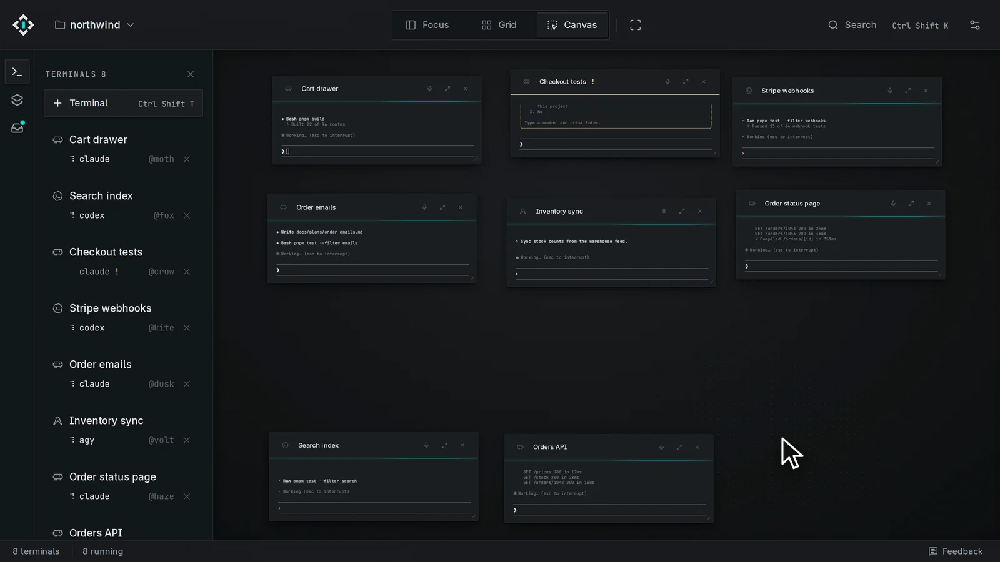

# Using Novadeck

A quick tour. Every detail is in the [reference](reference.md).

## Install

macOS and Linux:

```sh
curl -fsSL https://novadeck.dev/install.sh | sh
```

Windows: run the
[installer](https://github.com/novadeck-org/novadeck/releases/latest/download/novadeck-win-x64-setup.exe).
Portable builds are on [novadeck.dev/download](https://novadeck.dev/download).

## Connect your agents


Tick the agents you use. Novadeck adds a small plugin to each, so it can resume them after a
restart and pass messages between them. Then start them as usual: `claude`, `codex` or `agy`.

Codex may ask you to trust Novadeck's hooks. Do it with `/hooks`, or messages won't reach it.

## Three views


**Focus**: one terminal.


**Grid**: everything side by side.


**Canvas**: put terminals wherever you like. Scroll to zoom, drag to pan.


**Zen** (`Ctrl+Shift+Z`, `Cmd+Shift+Z` on macOS) hides everything else.


`Ctrl+Shift+K` (`Cmd+K`) finds any terminal by name.

## The Inbox



When an agent wants a permission, a plan approved or an answer, it lands in the Inbox. Most of
the time you answer with a button, right there.


Plans show in full before you approve them.


If you're looking elsewhere in Novadeck, a toast pops up. If you're in another app, you get a
system notification.


When an agent finishes, its short report waits here too.

## Teams


Every terminal has a handle like `@moth`. Agents use it to message each other, and one agent can
start others and lead them. The wires show who leads whom.


Click **Messages** on a terminal to read its conversations with other agents.

## Agents show you their work


An agent can open a page, an image, a plan or its changes in a pane right next to its terminal.

## After a restart

Terminals reopen where they were, and agents pick up their sessions. Closed terminals stay in
History for 30 days.

## Shortcuts

| Action                 | Windows and Linux                | macOS              |
| ---------------------- | -------------------------------- | ------------------ |
| Find a terminal        | `Ctrl+Shift+K`                   | `Cmd+K`            |
| New terminal           | `Ctrl+Shift+T`                   | `Cmd+T`            |
| Recent terminals       | `Ctrl+Tab`                       | `Ctrl+Tab`         |
| Move between terminals | `Ctrl+Shift+↑↓←→`                | `Cmd+Option+↑↓←→`  |
| Inbox                  | `Ctrl+Shift+B`                   | `Cmd+Shift+B`      |
| Zen                    | `Ctrl+Shift+Z`                   | `Cmd+Shift+Z`      |
| Pinned project 1–9     | `Ctrl+Shift+1` to `Ctrl+Shift+9` | `Cmd+1` to `Cmd+9` |
| Preferences            | `Ctrl+,`                         | `Cmd+,`            |

The full list is in the [reference](reference.md#keyboard-shortcuts).
