# Using Novadeck

A quick tour. Every detail is in the [reference](reference.md).

## Install

On macOS and x86_64 Linux:

```sh
curl -fsSL https://novadeck.dev/install.sh | sh
```

For Windows and portable builds, see [novadeck.dev/download](https://novadeck.dev/download).

## Connect your agents

Novadeck runs the agent CLIs you already have, so install at least one and sign in to it
first:

- [Claude Code](https://code.claude.com/docs/en/setup): `claude`
- [Codex](https://developers.openai.com/codex/cli): `codex`
- [Antigravity CLI](https://antigravity.google/docs/getting-started?tab=cli): `agy`

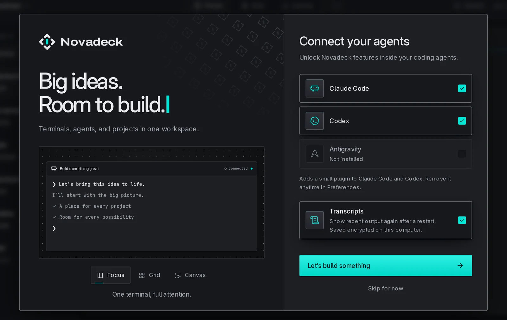

When you first open Novadeck, tick the agents you use. Novadeck adds a small plugin to each, so
it can resume them after a restart and pass messages between them. Then start them in any
terminal, the same way you always do.

Codex may ask you to trust Novadeck's hooks. Do it with `/hooks`, or messages won't reach it and it won't resume after a restart.

## Three views

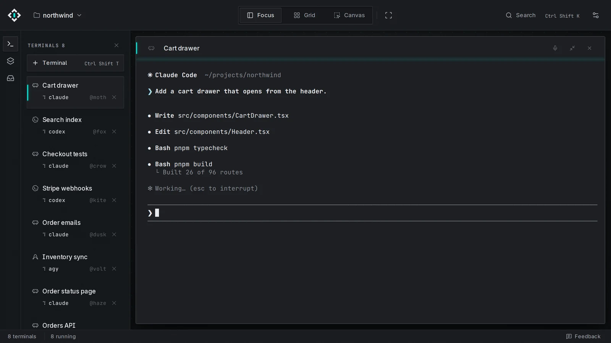

**Focus**: one terminal.

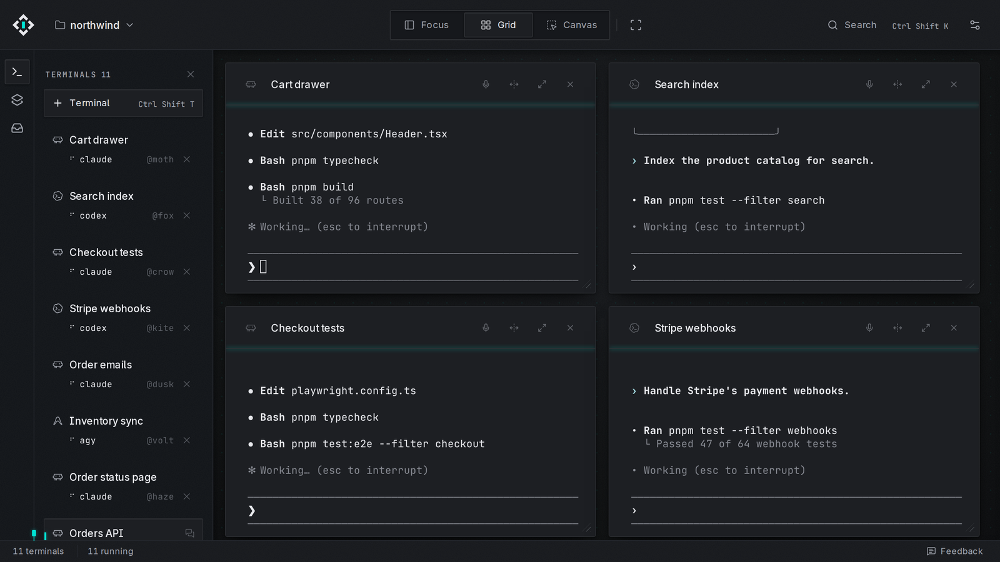

**Grid**: everything side by side, in the order of the Terminals list. Drag a terminal by its header to reorder.

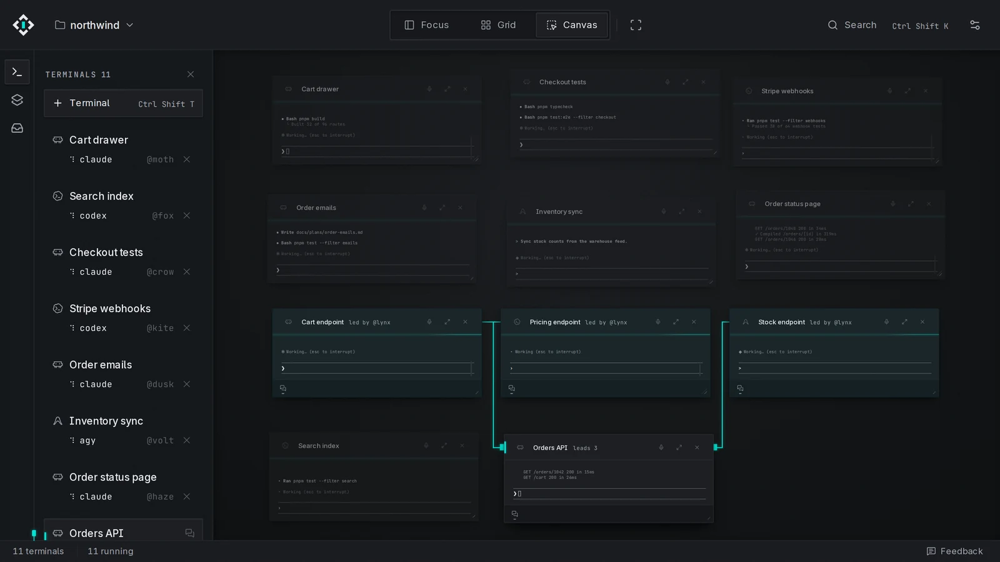

**Canvas**: every terminal on one board, laid out for you: each team beside its lead, the rest in a block in the sidebar's order. Scroll to zoom, drag to pan.

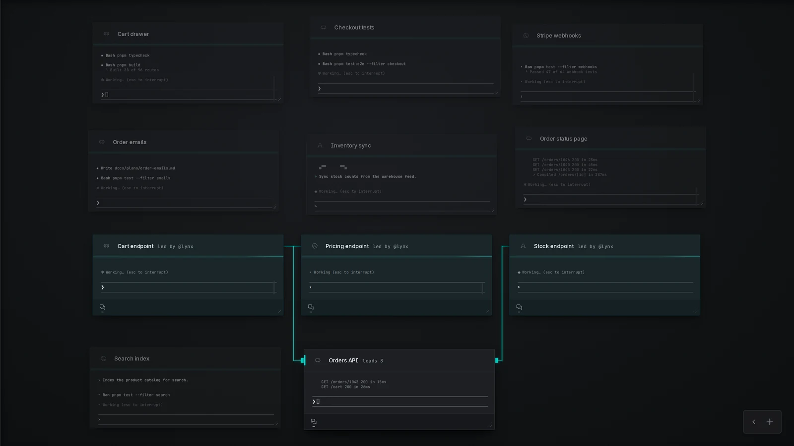

**Zen** (`Ctrl+Shift+Z`, `Cmd+Shift+Z` on macOS) hides everything else.

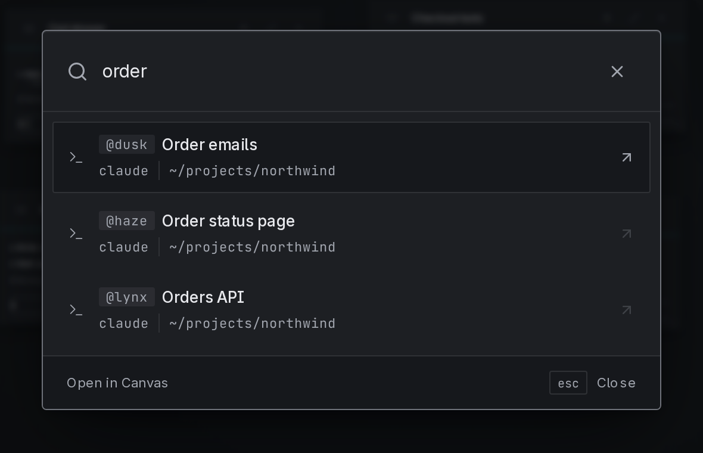

`Ctrl+Shift+K` (`Cmd+K`) finds any terminal by name.

## The Inbox

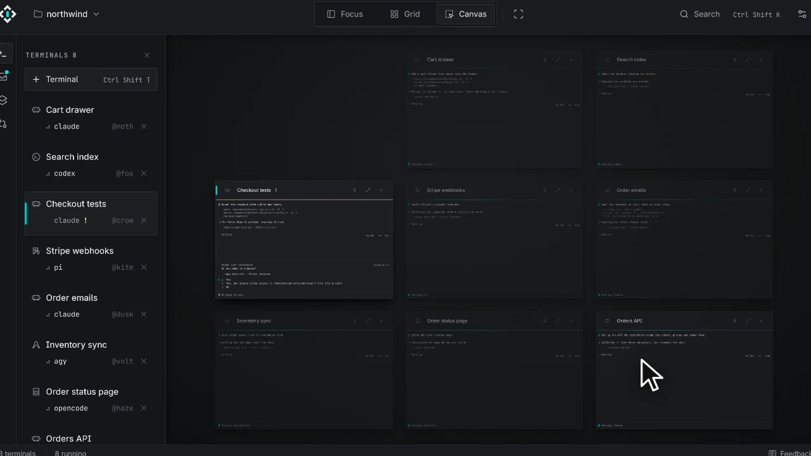

When an agent wants a permission, a plan approved or an answer, it lands in the Inbox. Most of
the time you answer with a button, right there.

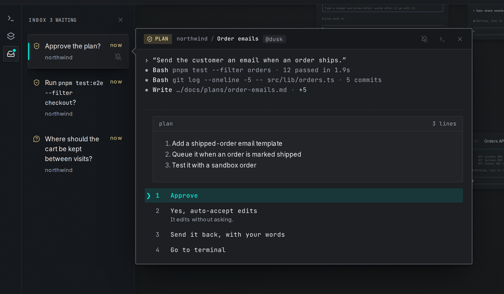

Plans show in full before you approve them.

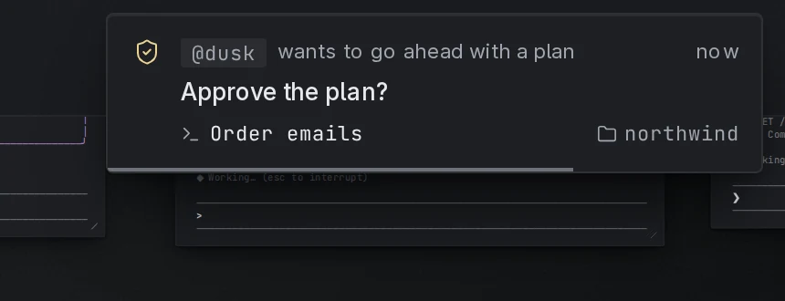

If you're looking elsewhere in Novadeck, a toast pops up. If you're in another app, you get a
system notification.

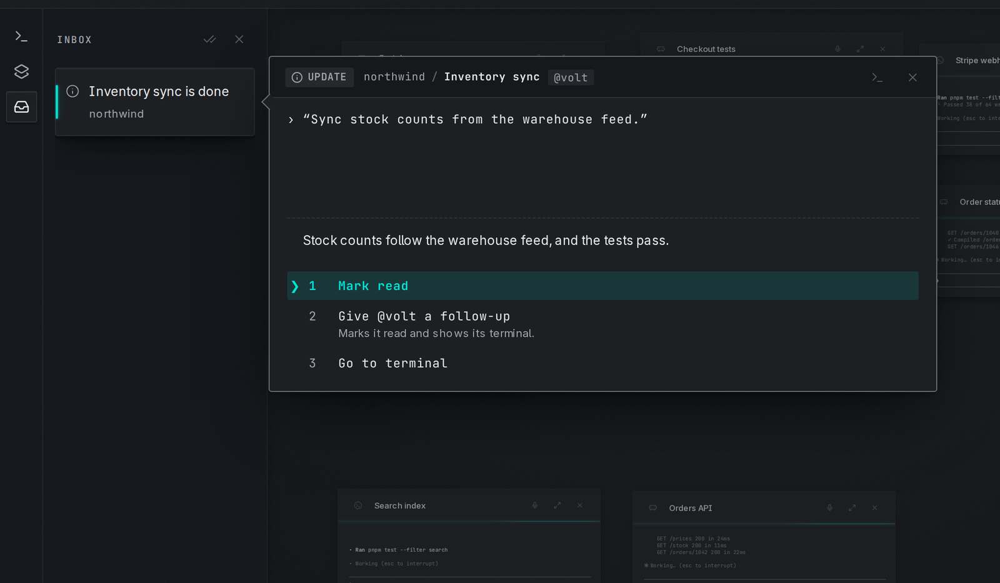

When an agent finishes, its short report waits here too. Opening it reads it.

Nothing you have dealt with disappears: an answered question, a dismissed one, a message you
released, a report you read all stay in the list in gray, saying how they ended, newest first,
and open as read-only cards. The list keeps the last ten of those; only a question an agent
withdrew itself leaves.

## Teams

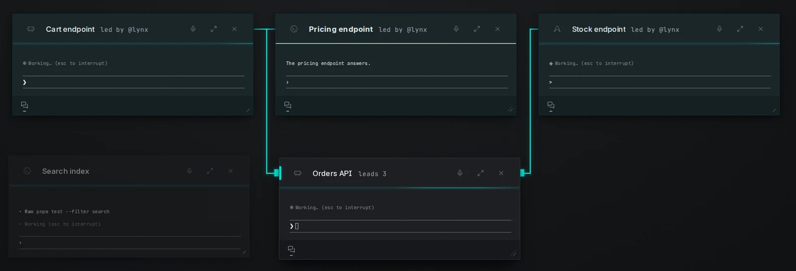

Every terminal has a handle like `@moth`. Agents use it to message each other, and one agent can
start others and lead them. The wires show who leads whom.

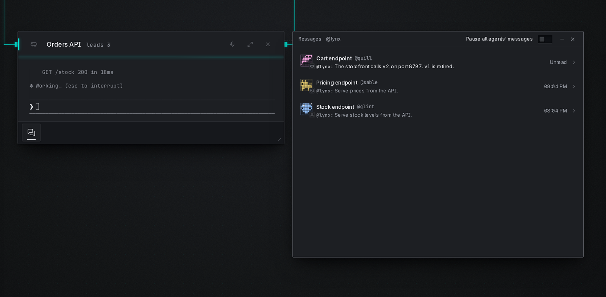

Once a terminal has messages, click its **Messages** icon to read its conversations with other agents.

## Worktrees

Agents make their own git worktrees, so they stay out of each other's way and out of your
checkout. The **Worktrees** panel lists them with their pull requests, and they're cleaned up once
merged. If you manage worktrees with another tool, turn **Agent worktrees** off in Preferences >
Agents.

A new worktree gets your checkout's ignored `.env` files. To copy other ignored files, such as
local config or certificates, list them in a `.worktreeinclude` file at the repository's top, in
`.gitignore` syntax. It replaces the `.env*` default, so list those too. A pattern without a `/`
picks files by their own name, outside ignored folders like `node_modules`; to copy a folder or
something inside one, write its path (`.venv/`, `certs/local/**`). Dependencies and build output
aren't copied unless you name them, and the agent is told what it got.

## Main stays current

Novadeck keeps `main` current in every git repository of an open project: the project's own folder,
if it's in one, and the repositories nested under it (down four folders, not in `node_modules` and
the like). It fetches each one every five minutes, and right away when a pull request of one of your
agents is merged, and moves `main` forward when that's safe: you're on `main`, have no changes to
tracked files, and no merge or rebase is half done.

The **Files** panel says where each repository stands, on its folder row (or on a line over the tree,
where the project is one repository): **3 new** when `main` just caught up, with a card listing the
merges, the files that changed (they pulse once in the tree) and the command to run if a lockfile
changed; **↓2** when `main` is behind and Novadeck left it alone (the card says why and has
**Update**); **↑1** for commits `main` has that origin doesn't. A closed folder that hides news
shows a dot, and so does the Files icon while the panel is hidden. You get a notification, per
Preferences > Notifications, only when a pull request of one of your agents lands in `main`, or when
new dependencies come in. Agents in the middle of a turn in a repository's own folder are told when `main` moved; idle ones aren't woken for it.

## Agents show you their work

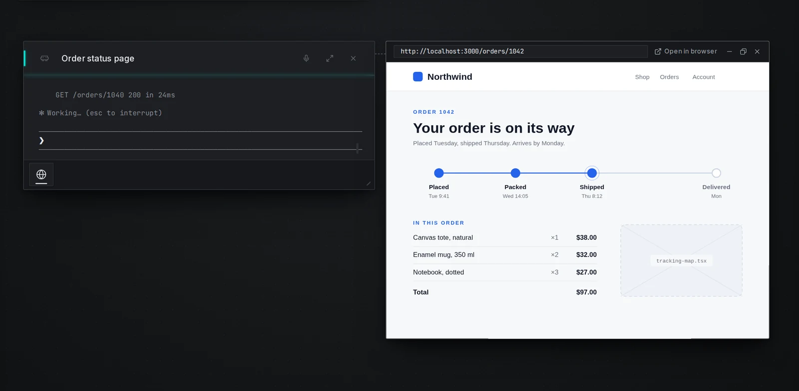

An agent can open a page, an image, a plan or its changes in a pane right next to its terminal.

## After a restart

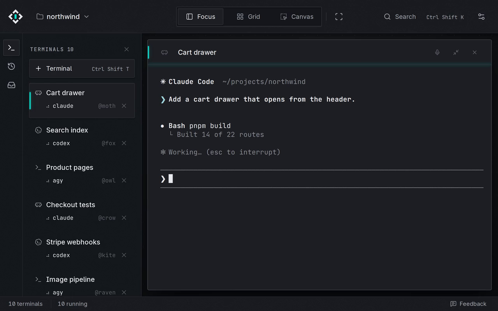

Terminals reopen where they were, and agents pick up their sessions. Closed terminals stay in
History for 7 days.

## Shortcuts

| Action                 | Windows and Linux                | macOS              |
| ---------------------- | -------------------------------- | ------------------ |
| Find a terminal        | `Ctrl+Shift+K`                   | `Cmd+K`            |
| New terminal           | `Ctrl+Shift+T`                   | `Cmd+T`            |
| Recent terminals       | `Ctrl+Tab`                       | `Ctrl+Tab`         |
| Move between terminals | `Ctrl+Shift+↑↓←→`                | `Cmd+Option+↑↓←→`  |
| Inbox                  | `Ctrl+Shift+B`                   | `Cmd+Shift+B`      |
| Zen                    | `Ctrl+Shift+Z`                   | `Cmd+Shift+Z`      |
| Pinned project 1–9     | `Ctrl+Shift+1` to `Ctrl+Shift+9` | `Cmd+1` to `Cmd+9` |
| Preferences            | `Ctrl+,`                         | `Cmd+,`            |

The full list is in the [reference](reference.md#keyboard-shortcuts).
